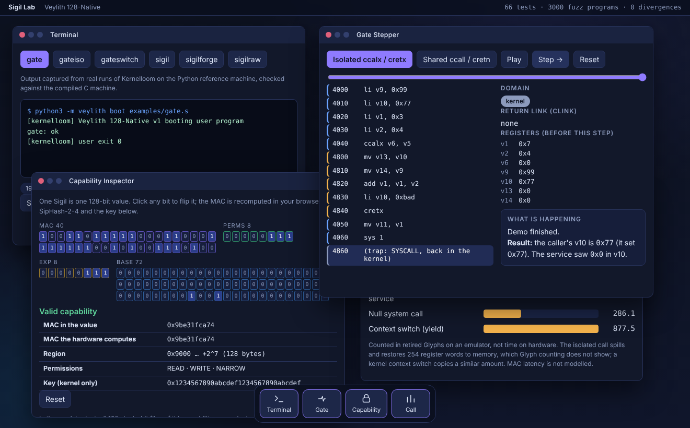
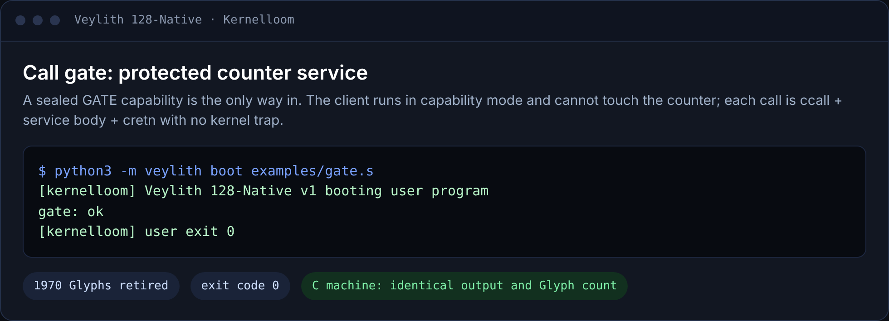
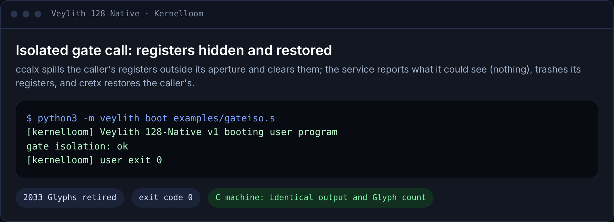
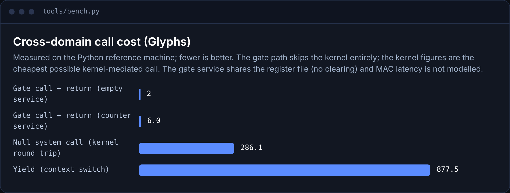

# 18 — Sigil capabilities (Veylith profile addendum)

**Status:** Implemented in the Python and C machines and in Kernelloom. Experimental; the MAC is SipHash-2-4, a published keyed PRF, truncated to 40 bits; the hardware latency of computing it is not modelled.

## 1. The idea

A **Sigil** is a complete memory capability that fits in *one* 128-bit register or *one* 128-bit memory word, with **no tag memory**. Unforgeability does not come from a hidden tag bit (as in CHERI) but from a 40-bit keyed MAC stored inside the capability and checked by hardware on every use. Because nothing lives outside the 128 bits, a Sigil can be copied by any ordinary instruction, stored in any memory, sent through the 128-bit mailbox, or serialised, without special tagged-memory support.

```
 127            88 87      80 79     72 71     64 63                       0
 +----------------+----------+---------+---------------------------+
 |   MAC (40)     | perms(8) | exp (8) | lenm1 (8) |      base (64)       |
 +----------------+----------+---------+---------------------------+
 perms: bit0 READ, bit1 WRITE, bit2 NARROW   region = [base, base + (lenm1+1) << exp), base aligned to 2^exp, exp <= 56, base + size <= 2^64
 MAC  : top 40 bits of F(ckey, bits[87:0])
```

## 2. Instructions, CSRs, cause

| Item | Definition |
|---|---|
| `cmint rd, ra, rb` | **Kernel only.** `ra` = base, `rb` = perms \| exp<<8 \| lenm1<<16. Produces a Sigil. Misaligned or out-of-range arguments trap `CAPABILITY`. |
| `cnarrow rd, ra, rb` | `rb` = perms \| exp<<8 \| offset<<16 (64 bits) \| newlenm1<<80. New perms must be a subset, region must be inside the old one and aligned; the source needs `NARROW`. Any violation, or an invalid source, traps. Monotonic: authority never grows. |
| `cinfo rd, ra` | Never traps. `rd` = `1<<127 \| bits[87:0]` if the MAC verifies, otherwise 0. Lets software read a capability's base/size/perms and test validity safely. |
| `clb`/`clq rd, [ra + imm]`, `csb`/`csq [ra + imm], rb` | Access through Sigil `ra`. Needs READ (loads) or WRITE (stores), `0 <= imm` and `imm + size <= (lenm1+1) << exp`. The effective address is `base + imm` and the normal checks (alignment, aperture, RAM) still apply. |
| CSR 11 `ckey` | 128-bit MAC key, kernel read/write. Changing it revokes every outstanding Sigil. |
| CSR 12 `cmode` | Non-zero = **capability mode** for user code: every raw load/store traps `CAPABILITY`; only `c*` accesses reach memory. |
| Cause 8 `CAPABILITY` | `tval` = the offending capability (or the raw effective address in capability mode). |

`F` = SipHash-2-4 (Aumasson and Bernstein, 2012) with the 128-bit `ckey` as key over the 88-bit body as 11 little-endian bytes; the MAC is the top 40 bits of the 64-bit tag. The implementation is checked against the official test vectors (`test_mac_is_siphash24_reference_vector`) and both machines agree on it under differential fuzzing.

## 3. Kernelloom integration (syscalls 10-12)

`capget(base, exp | lenm1<<8, perms)` mints a Sigil for a region inside the caller's aperture (else -1). `cmode()` puts the calling task into capability mode for good, and its spawned threads inherit it. `cwrite(cap, len)` prints through a READ Sigil instead of a raw pointer. A capability can be passed as a spawn argument or a mailbox message: a whole capability is one 128-bit value. `ckey` is set at boot from a constant so every run is reproducible; a real machine would need an entropy source.

## 4. Security properties and their evidence

| Property | Argument / test |
|---|---|
| Unforgeable (probabilistic) | A random 128-bit value verifies with probability about 2^-40. 300 000 random guesses: 0 accepted (`tools/bench.py`); 300 guesses in `test_random_values_are_not_capabilities`. |
| Tamper-evident | Flipping any one of the 128 bits invalidates a capability (`test_every_single_bit_flip_invalidates`). Avalanche of the stand-in MAC: 19.98 of 40 bits flip on average for a one-bit change (ideal 20). |
| Monotonic | `cnarrow` can only shrink perms and region; NARROW is dropped by default in handed-out capabilities (`test_narrowing_is_monotonic`). |
| Bounds and permission checked in hardware | `test_bounds_permissions_and_forgery_trap`. |
| Confinement | In capability mode raw access traps, so a task reaches only the regions it was handed (`test_capability_mode_forbids_raw_memory_access`, `examples/sigil{,forge,raw}.s`). |
| Revocation | Changing `ckey` invalidates all capabilities (`test_changing_the_key_revokes_everything`). Per-object revocation is not provided. |
| Two machines agree | The differential fuzzer includes capability operations, valid and invalid, with a trap handler (about 33 capability faults per program); 3000 programs, 0 divergences. |
| No extra instructions | A capability load costs the same Glyph count as a raw load in the loop benchmark (hardware MAC latency is not modelled). |

## 5. Trade-offs against nearby designs (honest)

* **Versus CHERI** (tagged 128-bit capabilities on a 64-bit machine): CHERI's tag makes forgery impossible and supports arbitrary bounds through compression; Sigil needs no tag storage and survives arbitrary byte-level copying, but forgery is only improbable, regions are power-of-two aligned, and a MAC must be computed on every use.
* **Versus Arm pointer authentication**: PAC puts a short MAC in the unused bits of a 64-bit pointer to protect a pointer's integrity; the 128-bit width lets Sigil carry a 40-bit MAC *plus* bounds and permissions, making the object a capability rather than just a signed pointer.
* **Versus Mungi/Amoeba password capabilities**: those are software-checked sparse capabilities; here the check is an instruction-level, load/store-path hardware check inside the machine model.

## 6. Limits

SipHash is a vetted short-input PRF, but truncating it to 40 bits is our design choice and its hardware latency is unstudied; 40-bit tag means about 2^39 expected online guesses, so the kernel must punish a failed use (Kernelloom halts); constant boot key; no per-object revocation; regions are `(lenm1+1) << exp` bytes (byte-exact up to 256, within 1/128 above), so alignment is only `2^exp`; capability-addressable memory is 2^64 bytes; the MAC check latency is unmodelled; no sealed/entry (call-gate) capabilities; no paging interaction defined.


## Sealed capabilities

`cseal rd, ra` sets perm bit 0x80 (SEALED) on a valid capability and re-MACs it. A sealed capability is an opaque token: it can be copied, stored and sent in a mailbox, but loads, stores and `cnarrow` through it trap (cause 8). `cunseal rd, ra` is kernel-only and clears the bit, so only a trusted service can turn a token it was handed back into authority (`cunseal` on an unsealed or invalid value traps). This gives handle-style capabilities without a separate object table. 

## Call gates

A *gate* is a sealed capability that also carries the `GATE` permission (0x08, mintable through `capget`). Its region holds a service: the region **base is the only entry point**. `ccall rd, ra` checks the MAC, requires SEALED and GATE and a region of at least 16 bytes, then in one Glyph: puts the return address in the kernel-only CSR 13 `clink`, loads `rd` with the same region as an *unsealed* data capability (the callee's own authority), and jumps to the base. `cretn` jumps back to `clink` and clears it. The caller never holds an unsealed capability to the service, so in capability mode it cannot read the service's data and cannot jump into the middle of it.

Measured (Python reference machine, `tools/bench.py`): a gate call and return costs 2 Glyphs for an empty service and 6 for a counter service, against 282 Glyphs for the cheapest possible kernel round trip (a null syscall) and about 874 for a context switch. Kernelloom saves and restores `clink` per task (`T_CLINK`), so a service may yield mid-call (`examples/gateswitch.s`; disabling the restore makes that example fault, which was checked).

Limits: calls do not nest (a second `ccall` while `clink` is set traps); the register file is shared, so a caller must treat registers as clobbered and a service can see caller registers (no clearing, no stack switch); a service that never returns blocks its task; MAC latency is not modelled; there is no per-service stack or fault isolation beyond the capability checks. Screenshots of real runs are in `docs/screenshots/` (generated by `tools/screenshots.py`).

## Isolated gate calls

`ccall` shares the register file, so a service can read the caller's registers and can leave junk in them. `ccalx` / `cretx` close that. `ccalx` writes `v1..v128` to a per-task save area named by the kernel-only CSR 14 `cstack` (Kernelloom points it at `0x21000 + tid * 0x800`, above the user aperture, so user code cannot read it), clears every register except the arguments `v1..v4`, puts the callee's data capability in `rd` and jumps to the gate entry. `cretx` restores `v3..v128` from the save area and keeps `v1` and `v2` as the results. The service therefore starts with no caller state, including `sp`, and anything it does to the caller's registers is undone. The kernel marks isolated calls with bit 127 of `clink` so `cretn` cannot end an isolated call and `cretx` cannot end a shared one (both trap), and the link is still saved per task, so isolated calls survive context switches.

`examples/gateiso.s` has the service count the caller secrets it can see (0), trash its registers, and return; the caller checks its own registers and `sp`. Cost: still 6 Glyphs for the counter service in the emulator's accounting, but each isolated call moves 254 register words to and from memory, about what a kernel context switch copies, so Glyph counts alone flatter it. Real hardware would want banked or windowed registers to make this cheap; that is not modelled. Not covered: a service can still fault, loop or never return, and the data capability it receives is not narrowed per call.

## Sigil Lab

`web/sigil-lab.html` is a self-contained desktop-style page with four windows: a terminal replaying captured example runs, a single-step viewer for gate calls (isolated or shared) built from a real instruction trace, a capability inspector that recomputes the SipHash MAC in the browser as you flip bits, and the cost chart. Rebuild it with `python3 tools/lab_data.py && python3 tools/build_lab.py`; every number and trace comes from the emulators.






## Length multiplier (layout change driven by measurement)

The first layout had power-of-two regions only (as in guarded pointers) and a 72-bit base. `tools/frag.py` traced real programs and showed 20-96% internal fragmentation and 60-283% peak-footprint overhead for that rounding (docs/20). The layout now uses a 64-bit base and an 8-bit length multiplier, so a region is `(lenm1+1) << exp` bytes: byte-exact up to 256 bytes, within 1/128 above. On the same traces the implemented rounding wastes 0.08-0.75%. Old encodings (multiplier 1) are unchanged. Cost: capability-addressed memory is 2^64 bytes, not the machine's 2^128. The fuzzer covers multipliers up to 4 on mint and up to 3 on narrow; the kernel `capget` takes `exp | lenm1<<8`.

## Verified-register flags and indexed accesses (cycle-model study)
Indexed capability Glyphs `clbx 0x8D`, `clqx 0x8E`, `csbx 0x8F`, `csqx 0x90` (format `rrr`): the byte offset is register `rb`; for the stores `rd` is the data source. Same bounds/permission rules as the immediate forms; an offset of 2^127 or more fails the bounds check.

A per-register **verified** flag is a microarchitectural optimisation with no architectural effect: it is set when the machine mints a capability (`cmint`, `cnarrow`, `cseal`, `cunseal`, gate data capability) or after a first successful MAC check, and cleared by any other write, by the spill/refill of `ccalx`/`cretx`, and on any write of `ckey`. `Machine.use_vok=False` disables it; `Machine.vok_audit=True` re-checks every flag hit. `tests/test_differential.py::VerifiedFlags` requires identical results with flags on and off over the fuzzer programs.

`tools/cyclemodel.py` runs six workloads with run-time indices (insertion sort, 8x8 matrix multiply, hash table, byte checksum, a linked list whose `next` field is a capability, and the same list over 512 KiB to stress a tag cache), measures capability uses, MAC computations with/without flags, a data-access stream for a CHERI-style tag-cache model, and registers dirtied per 3000-Glyph quantum, and writes `docs/paper/cyclemodel.json`. Findings: flags remove essentially all MACs in array loops; pointer-chasing code still pays about one MAC per new pointer; the tag-cache baseline is nearly free at small footprints but a 4-line tag cache thrashes on the 512 KiB list (64 lines do not); back-of-envelope SipHash latency puts L at roughly 8-13 cycles, not synthesis. **Limits:** MAC latency and tag-miss penalty are parameters, not measurements; workloads are small and hand-written; only one footprint (512 KiB) stresses a tag cache; no claim that Sigil is faster than tagged capabilities.
